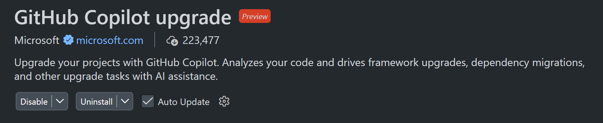
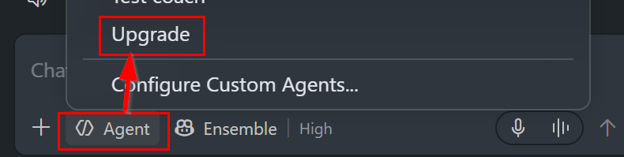

# Lab 1 - Modernize .NET (35 minutes)

**Start:** open the repository folder in VS Code; terminal in `starter`; app builds
on .NET 8. **Finish:** the same UI and API work on .NET 10.
This tiny dependency-free app makes the version upgrade intentionally low risk;
real applications require dependency compatibility and breaking-change analysis.

## 1. Assess and plan (10 minutes)

Install the VS Code extension
[GitHub Copilot upgrade](https://marketplace.visualstudio.com/items?itemName=ms-dotnettools.upgrade-agent).
Open **Extensions** (Ctrl+Shift+X on Windows/Linux; Cmd+Shift+X on macOS) and search
for `@id:ms-dotnettools.upgrade-agent`, then select **Install**.



If you see **Disable** and **Uninstall**, it is already installed.

In Copilot Chat, select **Upgrade** in the agent picker or send `@upgrade`.



If unavailable, use **Agent** with the prompt below; this is the manual fallback,
not the extension experience.

```text
Assess the ASP.NET Core .NET 8 app in starter/BookingLab for an upgrade to .NET 10.
Do not inspect reference solutions. Inventory projects, SDK pins, dependencies,
runtime/API risks, and verification gaps. Propose a minimal ordered plan that
updates both TargetFramework and global.json while preserving quote semantics,
the JSON contract, and the UI. Do not add Azure services or new packages.
Do not switch branches, commit, or push. Wait for my approval before editing.
```

Inspect the assessment and proposed changes. In this app there are no third-party
runtime packages to upgrade; "nothing else required" is a valid finding.
Require a verification plan even though tests have not been generated yet.
Generated assessment/plan locations vary by extension release; follow its links
rather than assuming a fixed filename.

## 2. Execute and verify (10 minutes)

```text
Apply the approved .NET 10 upgrade only in starter. Update the
SDK pin and target framework coherently, preserve all business behavior, build,
and tell me which checks actually ran. Stop if a prerequisite is unavailable.
Do not inspect reference solutions, change Git branches, commit, or push.
```

Review the diff: expect `net8.0` to become `net10.0` and the SDK major to become
10. SDK `10.0.100` with `latestFeature` is the reference selection; do not pin to
an uninstalled exact patch without a roll-forward strategy.
In the terminal at `starter`:

```text
dotnet --version
dotnet build BookingLab
dotnet run --project BookingLab --no-launch-profile --urls http://127.0.0.1:5180
```

Expect SDK 10.0.x, a successful build, healthy `/health`, and unchanged totals:
1 night / 1 guest = 110; 6 / 2 = 720; 7 / 2 = 756; 30 / 6 = 4320.
Stop the server with Ctrl+C.

If the upgrade extension is unavailable, use the built-in Agent role with the
same prompts. This is a **prompt-driven fallback**, not a demonstration of the
extension's assessment tools. Record that distinction.

## 3. Focused inline change (10 minutes)

Select the error-message string in the `guests` validation in
`starter/BookingLab/QuoteCalculator.cs`. Open inline chat (Ctrl+I on Windows/Linux,
Cmd+I on macOS), not an as-you-type completion:

```text
Improve only this exception's user-facing message to explain that guests must
be a whole number from 1 through 6 inclusive. Preserve the exception type,
parameter name, and business bounds. Do not refactor or change calculation.
```

Inspect and accept or discard the inline diff. A typed integer is already
enforced by model binding; do not claim this wording adds validation.
Build again. Path-specific instructions guide chat when supported; custom
instructions are not applied to ordinary as-you-type inline suggestions.

## 4. Exit check and recovery (5 minutes)

Explain why changing the target alone can leave a stale SDK pin, and why a
successful build does not prove the weekly discount still works.
If you need help, `reference/modernized` intentionally preserves the
original application sources; its only modernization changes are SDK and TFM.
The inline message edit is optional and not required for matching the reference.

If blocked, preserve your files, then from repository root:

```powershell
.\scripts\checkpoint.ps1 -Stage modernized -Name modernize-retry
```

```bash
bash scripts/checkpoint.sh modernized modernize-retry
```

Open the printed folder and continue there. No nonexistent tags/branches or
destructive reset commands are required.

Sources: [install and invoke Upgrade](https://learn.microsoft.com/dotnet/core/porting/github-copilot-upgrade/install),
[.NET breaking changes](https://learn.microsoft.com/dotnet/core/compatibility/),
[VS Code instructions](https://code.visualstudio.com/docs/agent-customization/custom-instructions).
