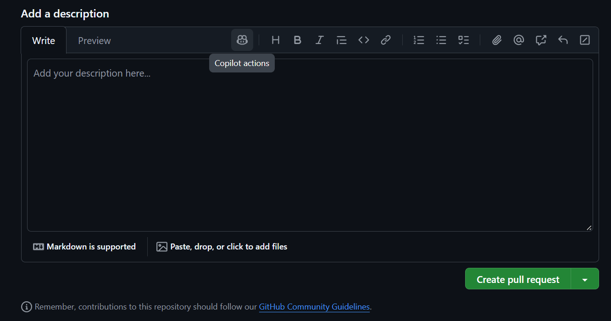

# Lab 2 - Instruction-driven review (25 minutes)

**Start:** runnable upgraded app. **Finish:** a review decision backed by
concrete failing examples. The deliberately flawed fixture is never compiled
or served. Do not replace the working calculator with it.

## 1. Read the review contract (5 minutes)

Keep the repository root open in VS Code. Read
`.github/copilot-instructions.md` and
`.github/instructions/csharp.instructions.md` (`applyTo: "**/*.cs"`).
The contract intentionally calls attention to inclusive bounds and the exact
weekly threshold. Instructions steer review; they do not guarantee findings.

Open `fixtures/review/WeeklyQuote.proposed.cs`. Compare it with the production
calculator; treat it as a proposed replacement, not an approved implementation.

## 2. Local review (8 minutes)

1. In `fixtures/review/WeeklyQuote.proposed.cs`, press **Ctrl+A** to select
   the code.
2. Press **Ctrl+Shift+P** to open the Command Palette.
3. Search for **Chat: Review** and run it.

Depending on your VS Code/Copilot version, the same action may also be available
by right-clicking **Generate Code > Review**. You do not need that menu to use
the Command Palette. This local selection review does not create a PR or commit
changes.

If **Chat: Review** is also unavailable, or for a reproducible prompt-based
comparison, attach the fixture and both instruction files to Chat and use this
read-only review prompt:

```text
Review this proposed calculator against the attached business contract and
C# review instructions. This is an inert training fixture: do not integrate
it into the running app. Report only concrete correctness issues, each with
a failing input, actual and expected result, and a minimal suggested fix.
Do not edit files and do not inspect reference solutions.
```

This chat-based review is a fallback/comparison, not the dedicated review UI.
If you want to practice **Copilot Code Review - Uncommitted Changes**, make a
small local edit in the fixture (for example rename `ProposedQuoteCalculator`
to `CandidateQuoteCalculator`), then click the review button above **CHANGES**
in Source Control. Review may focus only on the changed lines and miss the
existing defects; selection review is more suitable for this prepared fixture.

## 3. Inspect / accept / modify / reject (7 minutes)

For each suggestion, write one decision in your own notes:

| Decision | Evidence needed |
| --- | --- |
| Accept | Concrete contract violation; minimal fix; regression test |
| Modify | Real issue but suggested patch changes more than necessary |
| Reject | False positive, intentional behavior, or unsupported style claim |
| Investigate | Reproduce the example before deciding |

Apply fixes only to the **fixture**, inspect the resulting diff, and ask for a
regression test for each accepted issue. Applying a local suggestion does not
commit it. Do not blindly accept arithmetic rewrites or weakened validation.
If no comments appear, manually evaluate 0 nights and exactly 7 nights and
explain whether the contract is met. Do not inspect worked answers in `reference`
during the exercise.

## 4. GitHub PR review demonstration (optional, 5 minutes)

This is distinct from local review: the review happens on GitHub, on a pull
request (PR). It is **optional for attendees**. If your instructor is
demonstrating it, follow along on their PR instead of setting up your own.

**Ground rules**

- Use **your own fork** and a **new branch**. Do not ask for write access to
  this public training repo, and never open the PR against the upstream repo.
- Change only a fixture. Leave `starter/BookingLab` and `reference` untouched.
- Do not publish generated answers or secrets.
- Copilot PR review depends on your plan, repository/org settings and quotas;
  Copilot Chat access alone does not guarantee it. Agentic review can use
  GitHub Actions and incur usage, so check your billing/policy first. If
  **Copilot** does not appear under **Reviewers**, use the local review or
  the read-only prompt from section 2 instead.

### Create the branch and a reviewable fixture

Review focuses on lines that changed in the PR. Renaming a class would leave
the existing defects out of the diff, so add the fixture as a **new file**.
From the repository root in a terminal, in your fork's clone:

```powershell
git switch -c review/<your-name>-weekly-quote
Copy-Item fixtures/review/WeeklyQuote.proposed.cs fixtures/review/WeeklyQuote.pr.cs
```

In `WeeklyQuote.pr.cs`, rename `ProposedQuoteCalculator` to
`PrQuoteCalculator`. The fixture is still never compiled or served. Then:

```powershell
git add fixtures/review/WeeklyQuote.pr.cs
git commit -m "Add weekly quote fixture for Copilot review"
git push -u origin review/<your-name>-weekly-quote
```

### Open the PR against your fork

1. On your fork on GitHub, click **Compare & pull request**.
2. Check the **base repository** at the top of the page. GitHub may default to
   the upstream repo; change it to **your fork** so the base is your fork's
   `main` and the compare branch is your new branch.
3. Title it, for example, `Review a proposed weekly quote calculator`.
4. In the description box, click the **Copilot actions** button in the
   toolbar and choose the option to generate a summary. Copilot drafts a
   description from your changes, so you can skip writing one by hand.
   Availability depends on your plan and settings.

   

5. Read the generated summary and edit it. It should say that the file is an
   inert fixture and ask for concrete findings only (an exact input, actual
   result, expected result and a minimal fix). If the button is unavailable,
   paste the business contract from `.github/copilot-instructions.md` and
   write these points yourself.
6. Click **Create pull request**.

### Request the Copilot review

Copilot reads repository and path-specific instructions from the **head**
branch (the branch with your changes). Your branch has
`.github/copilot-instructions.md` and
`.github/instructions/csharp.instructions.md` as long as you did not delete
them from your fork. Do not assume that changing a custom-agent file selects
that agent for the GitHub PR reviewer; these are different surfaces.

1. In the PR sidebar, find **Reviewers**.
2. Next to **Copilot**, click **Request**.
3. Wait (typically under a minute), then read the **Files changed** comments.

Posting `@copilot review` in a comment does not start this review; use the
sidebar request. Copilot leaves a *Comment* review, not an approval, so it
does not satisfy required approvals.

### Triage the findings

Read suggestions as proposals. Findings are not guaranteed; if none appear,
manually evaluate 0 nights and exactly 7 nights against the contract.
For each comment, choose Accept, Modify, Reject or Investigate using the table
in section 3 and verify the arithmetic yourself.

- You can apply a correct suggestion from the comment, or edit the fixture and
  push another commit.
- You can reply to a comment to record your reasoning for human readers.
  Copilot does not necessarily see or answer thread discussion, so a reply is
  not an instruction to Copilot.
- Resolving a thread does not fix code. Resolve it only after fixing and
  verifying.
- After you push changes, Copilot does not necessarily review again. Click the
  **Re-request review** icon beside Copilot in the **Reviewers** section.
  A re-review may repeat comments you have already resolved.

AI review is not a substitute for required human approval or CI. This
fixture is not compiled, so a green CI run does not prove its calculations are
correct.

### Clean up

This is a disposable practice PR. Close it without merging; you can delete the
branch afterward.

**Exit check:** explain one finding with an exact input and why another proposed
suggestion could reasonably be rejected. Leave the production app unchanged.
For recovery, simply retain your edited fixture and reopen the original
calculator; no app checkpoint was modified by this exercise.

Sources: [local and PR review workflows](https://docs.github.com/en/copilot/how-tos/use-copilot-agents/use-code-review),
[repository and path instructions](https://docs.github.com/en/copilot/how-tos/copilot-on-github/customize-copilot/add-custom-instructions/add-repository-instructions),
[review concepts and availability](https://docs.github.com/en/copilot/concepts/agent-capabilities/agent-powered-workflows-and-operations/code-review).

---

Next: [Exercise 03: Tests](03-tests.md)
