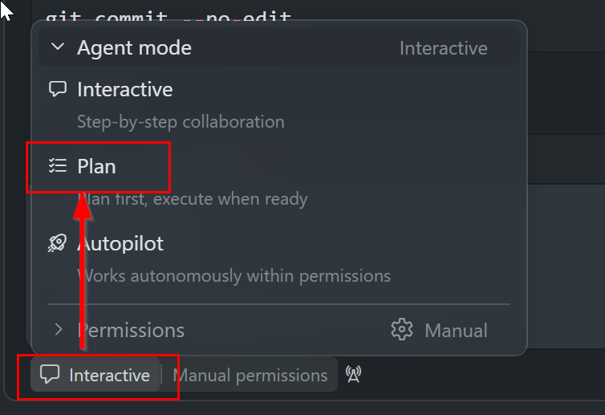

# Lab 4 - Combined challenge (20 minutes)

**Start:** your upgraded app and tests. **Finish:** one small requirement change
with a reviewed diff and test evidence. Keep reference checkpoints unchanged.

If the upgraded app or test sources are missing, complete the earlier labs first
rather than adding an upgrade or test framework to this challenge.

New requirement: stays of **14 or more nights receive 15% off**, replacing,
not stacking with, the 10% weekly discount. Stays of 7..13 nights still receive
10%. All input bounds, pricing and error behavior remain unchanged.

## Plan (3 minutes)

In Chat, select **Plan** mode and paste the prompt below. Discuss considerations,
answer any genuine open questions, and review the resulting plan. Requirements
already stated do not need a separate confirmation.



```text
Plan only; do not edit repository files or run installs or tests yet.
Inspect the app and tests under starter, not reference solutions.
Plan a minimal change: 7..13 nights still receive 10% off; 14..30 nights
receive only 15% off, replacing rather than stacking with the weekly discount.
Keep input bounds, pricing, rounding and error behavior unchanged.

Give independently calculated totals for 13, 14 and 30 nights with 2 guests.
Identify exact code, UI wording, instruction contract, unit-test and browser-test
files to change. Include boundary tests for 13 and 14 nights and update affected
maximum-boundary expectations. Preserve existing API validation, error tests
and stale-total clearing.

Keep implementation changes only under starter. Put the challenge-specific
contract under starter/.github; leave shared root instructions unchanged.
Plan to run unit and managed-server browser tests during implementation and
report actual commands and results. Do not change SDK or target frameworks,
edit reference checkpoints, commit, or push.

Do not ask me to reconfirm stated requirements. List considerations and missing
prerequisite lab outputs in the plan; do not silently add an upgrade or test
framework. Ask only about unresolved decisions that materially change scope
or behavior. Keep implementation deferred until I click Start Implementation.
```

## Implement and test (9 minutes)

Once the plan is ready, click **Start Implementation** to apply it and run its
validation steps. No second prompt or extra approval message is needed. Check
the actual unit and managed-server browser test results before moving to review.

If working in `starter`, repository-wide instructions are shared with the
training repo: put the challenge-specific contract in a new instruction file
under `starter/.github` rather than rewriting the root contract used by the
unchanged reference. Explicitly attach it to Chat. A recovered checkpoint
already has its own `.github` copy.

## Review and demonstrate (8 minutes)

Select the changed calculator and use VS Code's review action or attach the diff
to Chat. Supply the **new** contract so the reviewer does not apply the original
10% rule to all long stays. Decide which suggestions to accept and why.

Expected totals for 2 guests: 13 nights = **1404.00**, 14 nights = **1428.00**,
30 nights = **3060.00**. For 30 nights / 6 guests the new result is **4080.00**.
Do not change expected values without independently checking the requirement.
Demonstrate the 14-night UI total and existing invalid-input behavior.

**Exit check:** explain how the plan, review criteria and tests changed together.
For recovery, keep your edits and create a fresh `modernized` checkpoint using
the script in setup; no completed challenge solution is shipped intentionally.

## Wrap-up and buffer (10 additional agenda minutes)

Compare outcomes, not prompt wording. Record one accepted suggestion, one
rejected or modified suggestion, and the command that verifies your change.
Discuss when human review, broader integration tests and dependency migration
research would be necessary in a real application.

---

Next: [Exercise 05: Java (optional)](05-java-optional.md)
